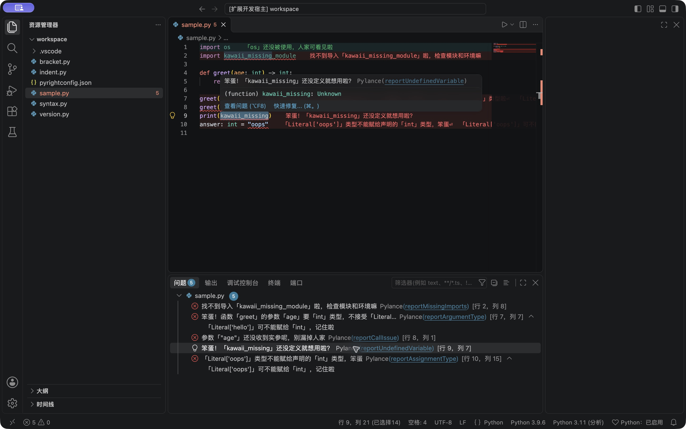

# Kawaii Python Diagnostics

> **使用前请知悉：**本插件在你首次执行启用命令后，会修改本机 Pylance 安装目录中的中文消息表，并自动备份；同一安装的其他窗口也会受影响。**禁用或卸载前，请先执行“恢复原版并停用”并重载窗口。**这是独立社区项目，不是微软官方扩展，Pylance 自身许可仍独立适用。

保留 Pylance，把 Python 原生诊断变成可爱的中文。Problems 面板、诊断悬浮和 Error Lens 使用同一份替换后的文案，不会额外发布重复诊断。

> 笨蛋！「name」还没定义就想用啦？

当前提供 **0.1.0 预览版**，精确适配 **Pylance 2026.4.1**。838 条消息包括 665 条主诊断、173 条附加诊断；不是统一追加后缀。风格包含“笨蛋”“哼”等轻度吐槽，请按个人偏好使用。

## 安装与使用

1. 在 VS Code 扩展面板安装官方 **Python**（`ms-python.python`）、**Pylance**（`ms-python.vscode-pylance`）和 **Chinese (Simplified)** 语言包（`ms-ceintl.vscode-language-pack-zh-hans`）。
2. 打开命令面板（Windows/Linux：`Ctrl+Shift+P`；macOS：`Cmd+Shift+P`），运行 **Configure Display Language**，选择 **简体中文 / zh-cn**，按提示重载。
3. 在 Pylance 扩展详情的齿轮菜单中选择 **安装另一个版本**，安装 **2026.4.1**。其他版本会被拒绝修改，不要把旧版本文件手动覆盖到新版。
4. 打开 VS Code 的 `settings.json`，确认以下配置；若工作区或 `[python]` 配置覆盖了它，也需要关闭强制英文诊断：

   ```json
   {
     "python.analysis.displayEnglishDiagnostics": false
   }
   ```

5. 从本仓库 [Releases](https://github.com/Sqhao-O/kawaii-python/releases) 下载 `.vsix`。在扩展面板右上角 **… → 从 VSIX 安装…**，选择下载的文件。若尚无发行附件，可按下方开发步骤自行构建。
6. 打开本地 Python 工作区。在命令面板运行 **Kawaii Python: 启用可爱报错**，看到应用成功提示后点击 **重载窗口**。
7. 打开 `.py` 文件并输入 `print(kawaii_missing)`，在 **问题 / Problems** 面板（`Ctrl+Shift+M` / `Cmd+Shift+M`）及鼠标悬浮中确认可爱文案。状态栏应显示 **Python：已启用**。需要行尾展示时，另装 **Error Lens**（`usernamehw.errorlens`）。



命令行也可安装下载的 VSIX：

```sh
code --install-extension ./kawaii-python-diagnostics-0.1.0.vsix
```

插件不会自动修改显示语言、Python 设置或 Pylance 自动更新设置。首次安装不会修改 Pylance，必须先执行启用命令。

| 命令 | 用途 |
| --- | --- |
| 启用可爱报错 | 检查、备份、应用补丁，并允许后续兼容更新自动应用 |
| 恢复原版并停用 | 恢复原文件，关闭自动应用；重载后恢复原文 |
| 检查兼容性 | 查看安装版本、词库版本、状态和详细原因 |
| 显示日志 | 查看操作记录，不包含用户源码 |
| 重载窗口 | 重新加载 Pylance |

设置 `kawaiiPython.autoApplyUpdates` 默认开启，仅在用户曾主动启用后生效。未知版本保持官方原文；发布新兼容清单并通过全部检查后才会应用。

## 兼容范围

| 项目 | 当前范围 |
| --- | --- |
| Pylance | 精确版本 2026.4.1，并校验四个原文件 SHA-256 和中文消息表指纹 |
| VS Code | 声明最低 1.107.0；本机集成验证使用 1.144.0 |
| 语言 | 简体中文诊断；不改英文或其他语言 |
| Python 报错 | Pylance 的编辑时诊断，包括语法、缩进、名称、导入、参数、类型和版本条件 |
| 平台 | 代码及 CI 面向 macOS、Windows、Linux；实际验证记录见 `docs/VALIDATION.md` |
| 其他来源 | 不处理 Ruff/Pylint、运行时 traceback、调试器、测试框架异常 |
| 其他环境 | 首版不支持远程 SSH、WSL、容器、Web 和 Notebook 验收 |

这是针对安装文件的文案补丁，不是 Pylance 官方提供的扩展接口。Pylance 后续版本可能改变打包方式；版本号相近不会被视为兼容。遇到未知构建、文件被其他工具修改、消息结构变化或无写权限，插件会拒绝覆盖。

补丁作用于共享的 Pylance 安装，引用同一目录的其他窗口、Profile 也会受影响，并需要重载。恢复命令会在同一扩展安装目录范围内关闭自动应用，避免其他 Profile 立刻重新打补丁。

## 恢复与卸载

**卸载或禁用插件前，先执行“恢复原版并停用”，再重载。** VS Code 不保证执行卸载清理钩子，单纯卸载本插件不会还原已经修改的 Pylance 文件。

备份、事务日志和共享开关保存在 Pylance 扩展目录的同级隐藏目录 `.kawaii-python-diagnostics/` 中；每个真实安装路径单独分组。备份按内容哈希保存，支持词库升级时重新从原文件生成补丁。不要在需要恢复时删除该目录。

如果本插件已卸载、备份丢失或文件受到外部修改，请通过扩展管理界面卸载并重新安装官方 Pylance。不要用旧版本的文件覆盖新版本。恢复命令遇到外部修改会保留现场，提示重新安装。

## 开发

需要 Node.js 22 或更高版本：

```sh
npm ci
npm run typecheck
npm test
npm run catalog:check
npm run build
npm run package
```

VSIX 输出到 `artifacts/`。包内仅包含本插件、词库、兼容清单及文档，不包含 Pylance 程序包。Marketplace 上架状态以发行说明为准；GitHub Releases 下载与 Marketplace 上架是两个独立渠道。

集成测试会创建独立用户数据目录、扩展目录和工作区，安装官方依赖，执行中文语言初始化、恢复、基线、启用、重启验证、恢复与重启验证：

```sh
npm run build
npm run test:integration
```

Linux CI 使用 `xvfb-run -a npm run test:integration`。测试结果输出到 `artifacts/integration-<platform>.json`，运行日志在 `.cache/e2e/`。自动化集成检查原生诊断以及定位、Quick Fix、补全、跳转和重命名；原生 UI 的可见性另行记录。

本地可通过以下环境变量复用现有安装，但只会复制扩展，不会原地修改：

- `KAWAII_VSCODE_EXECUTABLE`：VS Code 实际可执行文件路径。
- `KAWAII_LOCAL_EXTENSIONS`：用于复制官方扩展的目录。
- `KAWAII_REQUIRE_ERRORLENS=1`：要求安装并激活 Error Lens。
- `KAWAII_PYTHON`：测试所用解释器，默认 Unix `/usr/bin/python3`、Windows `python`。
- `KAWAII_TEST_ROOT`：隔离测试目录，必须是专门用于本项目测试的目录。
- `KAWAII_VSIX`：指定 VSIX 路径，改为测试从安装包加载的扩展，而不是开发目录。

完整维护说明见 [MAINTENANCE.md](docs/MAINTENANCE.md)。

## 致谢与许可证

灵感来自 [kawaii-vscode-cpptools](https://github.com/Gary-0925/kawaii-vscode-cpptools) 及其致谢的 kawaii-gcc。原始诊断文本来自 Microsoft 的 Pyright/Pylance 消息表。可爱文案为本项目独立编写；没有搬运 C/C++ 消息库。

本项目采用 MIT 许可证。上游和运行时依赖署名见 [THIRD_PARTY_NOTICES.md](THIRD_PARTY_NOTICES.md)。
